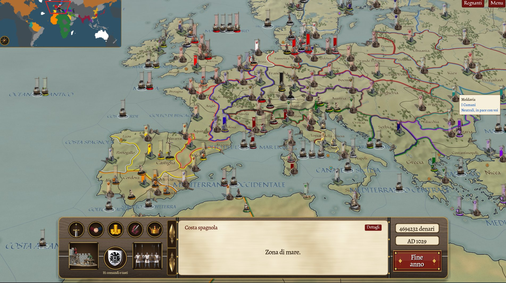
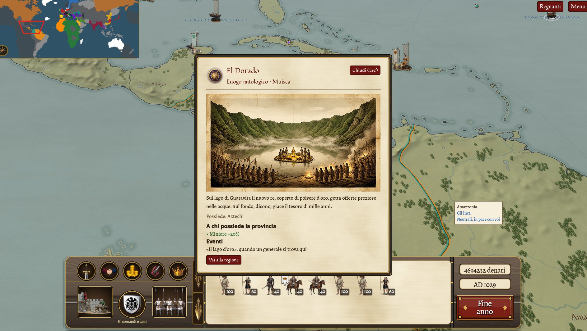
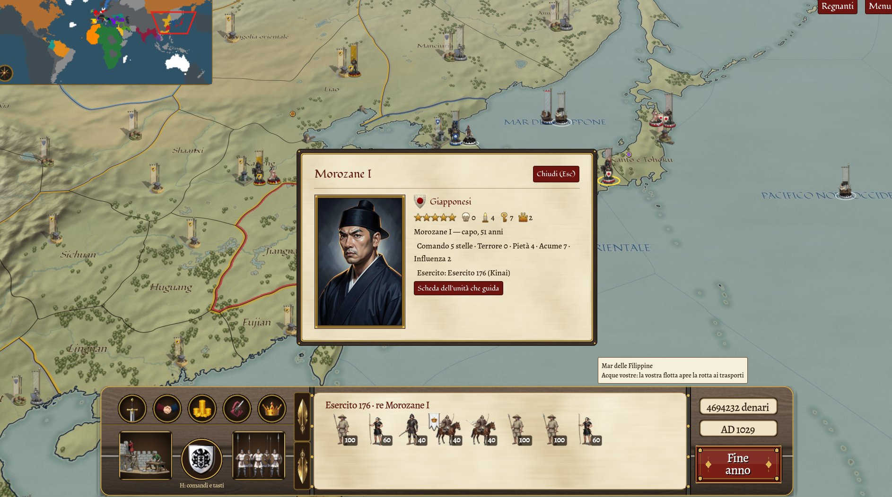
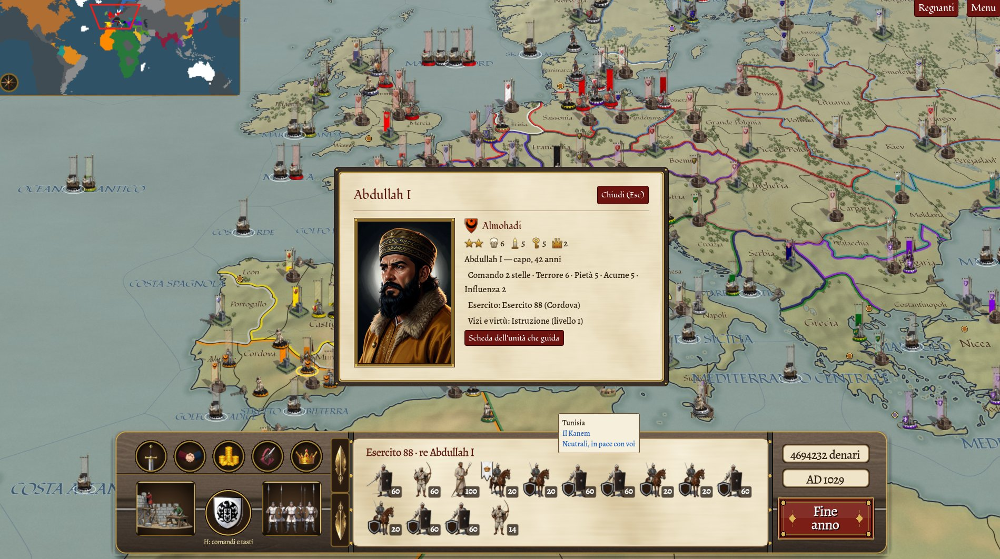
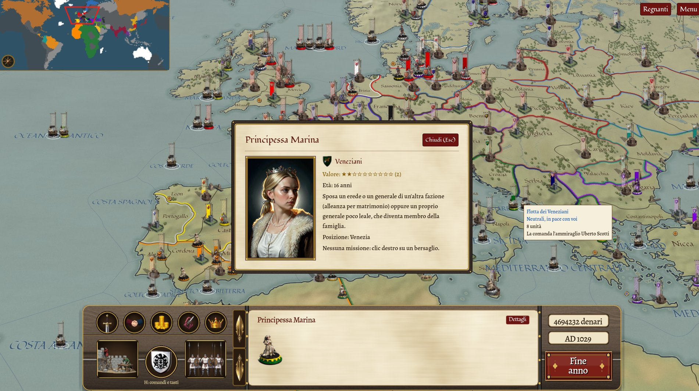

# Medieval Quest

🇮🇹 Italiano · 🇬🇧 [English](#english)

Gioco di strategia a turni, per un solo giocatore, sulla mappa del mondo dal 1000 al 1700. È ispirato alla campagna di **Medieval: Total War** (con la mod XL 3.0): stessi meccanismi di dinastie, emissari, spie, crociate, Papato ed eventi storici, ma senza battaglie 3D. Scontri e assedi si risolvono in automatico e tutto si gioca sulla plancia.

Il gioco è scritto da zero con [Godot Engine 4.7](https://godotengine.org) (GDScript). Non serve avere installato il gioco originale.

> **Progetto amatoriale e open, senza supporto.** Il codice è sotto licenza MIT (vedi [LICENSE](LICENSE)). Non ci sono garanzie, assistenza, aggiornamenti programmati né tempi di risposta: issue e richieste possono restare senza risposta. Usalo così com'è.

## Schermate

| | |
|:---:|:---:|
|  |  |
| Luoghi leggendari: El Dorado, con i suoi bonus e un evento | Re e generali con ritratto, stelle e attributi |
|  |  |
| Il capo degli Almohadi e le unità della sua armata | Agenti: una principessa pronta a combinare un matrimonio |

## Scaricare e installare

1. Apri la pagina [Releases](../../releases) e scarica l'ultimo `MedievalQuest-Setup-<versione>.exe`.
2. Avvia l'installer. Non servono diritti di amministratore: di default il gioco va in `%LOCALAPPDATA%\Programs\Medieval Quest`.
3. Avvia **Medieval Quest** dal menu Start o dal collegamento sul desktop.

Windows può mostrare l'avviso di SmartScreen perché l'installer non è firmato: «Ulteriori informazioni» → «Esegui comunque».

**Aggiornamenti:** all'avvio il gioco chiede a GitHub se c'è una versione più recente e, se c'è, lo segnala nel menu iniziale con un pulsante per scaricarla. Basta installarla sopra la precedente: salvataggi e impostazioni restano. Il controllo si spegne da Impostazioni.

**Requisiti:** Windows 10 o 11 a 64 bit, scheda video compatibile con Vulkan o OpenGL 3.3 (va bene anche una grafica integrata recente), circa 1 GB di spazio libero.

**Salvataggi e impostazioni** stanno in `%APPDATA%\Godot\app_userdata\MTW Remake`. La disinstallazione non li cancella.

## Come si gioca

La guida completa, con comandi e regole principali, è in [docs/GUIDA_DI_GIOCO.md](docs/GUIDA_DI_GIOCO.md) (in inglese: [docs/GAME_GUIDE.md](docs/GAME_GUIDE.md)); l'installer le copia entrambe nella cartella del gioco. In partita il tasto **H** mostra l'elenco dei comandi.

## Diritti e crediti

*Medieval: Total War* e *Total War* sono marchi e opere dei rispettivi titolari (The Creative Assembly / SEGA; il gioco originale è stato pubblicato da Activision nel 2002). Medieval Quest è un progetto di fan **non ufficiale**, senza scopo di lucro, non affiliato né approvato da loro. Il gioco non contiene file dell'originale: immagini, musiche ed effetti sono nuovi o da librerie libere. I dati della campagna (province, fazioni, unità, edifici, nomi) derivano da quelli dell'originale e della mod XL.

Dettagli, crediti di caratteri, motore e immagini in [CREDITI_E_DIRITTI.md](CREDITI_E_DIRITTI.md).

## Per chi vuole modificarlo

Codice, dati e strumenti sono in questo repository. Come aprire il progetto, eseguire i test e ricostruire eseguibile e installer è spiegato in [docs/SVILUPPO.md](docs/SVILUPPO.md).

---

## English

Medieval Quest is a free, single-player, turn-based strategy game on the world map from 1000 to 1700. It is inspired by the campaign of **Medieval: Total War** (with the XL 3.0 mod): dynasties, emissaries, spies, crusades, the Papacy and historical events work the same way, but there are no 3D battles. Fights and sieges are resolved automatically and everything is played on the campaign map. The game can be played in English or Italian (language choice in the main menu).

It is written from scratch with [Godot Engine 4.7](https://godotengine.org) (GDScript). The original game is not needed.

> **Hobby project, open source, no support.** The code is MIT-licensed (see [LICENSE](LICENSE)). There are no warranties, no support, no update schedule and no response times: issues and requests may stay unanswered. Use it as is.

### Screenshots

| | |
|:---:|:---:|
|  |  |
| Legendary places: El Dorado, with its bonuses and an event | Kings and generals with portrait, stars and attributes |
|  |  |
| The leader of the Almohads and the units of his army | Agents: a princess ready to arrange a marriage |

### Download and install

1. Open the [Releases](../../releases) page and download the latest `MedievalQuest-Setup-<version>.exe`.
2. Run the installer. No administrator rights are needed: by default the game goes to `%LOCALAPPDATA%\Programs\Medieval Quest`.
3. Start **Medieval Quest** from the Start menu or the desktop shortcut.

Windows may show a SmartScreen warning because the installer is not signed: "More info" → "Run anyway".

**Updates:** at startup the game asks GitHub whether a newer version is available and, if so, shows it in the main menu with a download button. Just install it over the previous one: saves and settings are kept. The check can be turned off in Settings.

**Requirements:** 64-bit Windows 10 or 11, a graphics card supporting Vulkan or OpenGL 3.3 (a recent integrated GPU is fine), about 1 GB of free space.

**Saves and settings** are stored in `%APPDATA%\Godot\app_userdata\MTW Remake`. Uninstalling does not delete them.

### How to play

The full guide, with controls and main rules, is in [docs/GAME_GUIDE.md](docs/GAME_GUIDE.md) (Italian original: [docs/GUIDA_DI_GIOCO.md](docs/GUIDA_DI_GIOCO.md)); the installer copies both to the game folder. In game, press **H** for the list of controls and keys.

### Rights and credits

*Medieval: Total War* and *Total War* are trademarks and works of their respective owners (The Creative Assembly / SEGA; the original game was published by Activision in 2002). Medieval Quest is an **unofficial**, non-profit fan project, not affiliated with or endorsed by them. The game contains no files from the original: images, music and sound effects are new or come from free libraries. Campaign data (provinces, factions, units, buildings, names) is derived from the original game and the XL mod.

Details and credits for fonts, engine and images are in [CREDITI_E_DIRITTI.md](CREDITI_E_DIRITTI.md).

### For modders

Code, data and tools are in this repository. How to open the project, run the tests and rebuild the executable and the installer is explained in [docs/SVILUPPO.md](docs/SVILUPPO.md) (Italian).
